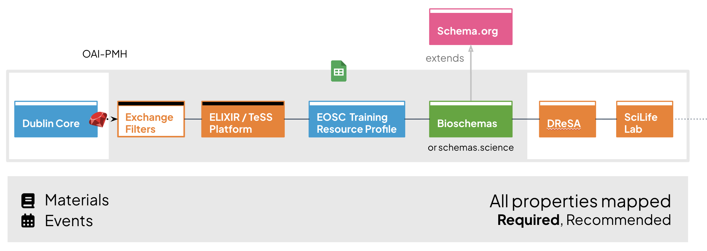

# TeSSHub metadata model

Minimum metadata model and all-to-all exchange for the TeSS Platform, suitable for federation with EOSC.

This model is the output from a series of online workshops where we define the metadata model used in the TeSS Platform for exchange with other training registries in any domain. We started with the mapping work from the mTeSS-X focus group then refined the outputs over events in February, March and May 2026. The goal was to reach a consensus of a minimum metadata model for exchange (all-against-all) that is appropriate for the federation of learning materials across EOSC. 

## Introduction

The [**mTeSS-X** (Multi-tenanting TeSS eXchange) project](https://elixirtess.github.io/mTeSS-X/) builds upon the **ELIXIR TeSS platform** to address the fragmentation of training resources across Research Infrastructures (RIs) and scientific domains. Through the implementation of **multi-tenancy**, we can share training resources between disciplines while maintaining unique training catalogues within a single shared instance. Additionally, the TeSS-X plugins will be introduced to enable seamless content **exchange** between catalogues hosted as separate instances. 

The work continues through [TeSSHub4EOSC](https://eosc.eu/horizon-europe-projects/tesshub4eosc), an EOSC Gravity inter-project, which will establish a distributed, FAIR-compliant catalogue infrastructure for training materials and events within the European Open Science Cloud (EOSC). The primary outcome will be a central TeSSHub instance complementing discipline-specific catalogs like ELIXIR TeSS and PaN- Training. This instance will allow EOSC nodes, communities, science clusters, and competence centers to create custom-branded views or spaces with their own content, without maintaining separate infrastructure. The solution will also support the EOSC Academy, fostering scalable and sustainable access to training materials across EOSC.

## Features

* The work has a foundation in the TeSS Platform, founded in ELIXIR (European RI for life sciences) in 2016. Materials and events are serialised from TeSS according to [Bioschemas](https://bioschemas.org/), a specialised set of profiles building on [Schema.org](http://Schema.org).   
* Instances of the TeSS Platform are deployed and customised in multiple domains, especially PaNOSC (photon and neutron training) and EVERSE (research software quality), both of whom collaborate with ELIXIR through the mTeSS-X OSCARS project. Features are added from these and other communities, including additions to the TeSS data model.   
* This proposed updated minimum metadata model builds on work from [RDA (2022)](https://doi.org/10.15497/RDA00073), [Skills4EOSC (2025)](https://www.skills4eosc.eu/resources/quality-assurance-certification-framework), Flemish RDM, ELIXIR BioHackathon Europe, de.NBI BioHackathon Germany, NFDI, DALIA, EOSC Training WG, mTeSS-X, ELIXIR TeSS Club.  
* It is a collection of properties and suggested vocabularies that are the minimum required for FAIR training material and event discovery and exchange. It considers materials being automatically ingested into a TeSSHub instance, either from the web or directly from another TeSSHub instance.  
* This work considers materials and events side-by-side (a material is considered an event if it has a date and location). Previous work has focused on materials, not events.  
* We add properties as advised by the mTeSS-X focus group and EOSC training and competencies working group, appropriate for the federation of materials across EOSC. 
* The [attributes are described](https://doi.org/10.5281/zenodo.23270021) by the TeSSHub4EOSC EOSC Gravity interproject.

## Files

- `images/`
  - `all-to-all-diagram.png`: Graphical representation of the mapping
- `models/`
  - `all-to-all-mapping.csv`: All-to-all mapping, CSV format
  - `all-to-all-mapping.xlsx`: All-to-all mapping, Excel format
  - `minimum-metadata-model.csv`: Excerpt with required and recommended properties for TeSSHub, CSV format
  - `minimum-metadata-model.xlsx`: Excerpt with required and recommended properties for TeSSHub, Excel format
- `LICENSE`: Creative Commons Zero 1.0 license
- `README.md`: This document

## Minimum metadata model

An excerpt of the all-to-all mapping is provided with the required and recommended properties for TeSSHub. The following properties are described as one of:

- Required
- Required if exists*
- Recommended
- Optional 

Most of the optional properties are omitted in the minimum model for clarity. They are described in the all-to-all mapping. *Some properties are only required if they exist; these may be implemented similar to Recommended properties.

### Describing the minimum model

| Column | Description |
|:---------|:------------|
|Minimum metadata model 2026 Material | Name of property in Material |
|Minimum metadata model 2026 Event | Name of property in Event |
|MMM 2026 Expected Schemaorg Type | What Schema.org type(s) are expected |
|MMM 2026 Cardinality | Could there be ONE or MANY values |
|MMM 2026 Values / CV | What controlled vocabulary or values should be used |
|MMM 2026 Material Required | Is this property required or recommended for Materials |
|MMM 2026 Event Required | Is this property required or recommended for Events |
|RDA Description | Property description from RDA metadata model |
|TeSS Description |  Property description from the TeSS Platform  |
|Example 1 (Material) | Populated real example of a Material |
|Example 2 (Event) | Populated real example of an Event |

## All-to-all mapping

The columns in the full model are grouped as follows:

### Ingestion / core TeSS

| Column | Description |
|:-------|:------------|
| Dublin Core | Source property from Dublin Core used as an input reference for mapping and ingestion. |
| Can filter at TeSS exchange | Indicates whether this field can be used as a filter during TeSS content exchange workflows. |
| Filter comment | Notes explaining filter logic, constraints, or usage guidance for exchange. |
| TeSS Material property | Corresponding property name used in the TeSS data model for Materials. |
| TeSS Event property | Corresponding property name used in the TeSS data model for Events. |
| Property comment | General notes clarifying semantics, expected values, or implementation details of the property. |
| DC ingestion comment | Notes specific to how Dublin Core values are interpreted, transformed, or handled during ingestion. |

### EOSC Training Resource Profile 2024

| Column | Description |
|:-------|:------------|
| EOSC Training Property 2024 | Corresponding property name from the EOSC Training Resource Profile (2024) used for crosswalk mapping. |
| EOSC comment | Notes on interpretation, scope, or special considerations for EOSC profile alignment. |

### TeSSHub Minimum metadata model
| Column | Description |
|:-------|:------------|
| Minimum metadata model 2026 Material | Property name defined in the TeSSHub 2026 minimum model for Materials. |
| Minimum metadata model 2026 Event | Property name defined in the TeSSHub 2026 minimum model for Events. |
| MMM 2026 Expected Schemaorg Type | Expected Schema.org type(s) for values mapped to this property. |
| MMM 2026 Cardinality | Expected number of values allowed (for example, one or many). |
| MMM 2026 Values / CV | Expected value format or controlled vocabulary for this property. |
| MMM 2026 Material Required | Requirement level for Materials (for example required, recommended, optional). |
| MMM 2026 Event Required | Requirement level for Events (for example required, recommended, optional). |

### Bioschemas serialization 
| Column | Description |
|:-------|:------------|
| Bioschemas property in TrainingMaterial | Target Bioschemas property used when serializing a Material as TrainingMaterial. |
| Bioschemas property in CourseInstance | Target Bioschemas property used when serializing an Event as CourseInstance. |
| Bioschemas serialised by TeSS | Indicates whether and how the property is currently output by TeSS in Bioschemas markup. |
| Bioschemas subproperties | Subproperty paths or nested fields relevant to the Bioschemas mapping. |
| Bioschemas notes | Additional implementation notes, caveats, or version-specific guidance for Bioschemas. |

### DReSA
| Column | Description |
|:-------|:------------|
| DReSA Material property | Equivalent DReSA property used for mapping Material metadata. |
| DReSA Event property | Equivalent DReSA property used for mapping Event metadata. |
| DReSA comment | Notes about mapping assumptions, differences, or constraints for DReSA integration. |

### SciLifeLab
| Column | Description |
|:-------|:------------|
| SciLifeLab Material property | Equivalent SciLifeLab property used for mapping Material metadata. |
| SciLifeLab Event property | Equivalent SciLifeLab property used for mapping Event metadata. |
| SciLifeLab comment | Notes about interoperability details, interpretation, or edge cases for SciLifeLab mappings. |

### RDA Learing Resource 2021
| Column | Description |
|:-------|:------------|
| RDA Learning Resource Minimum 2021 | Corresponding field in the RDA Learning Resource Metadata model (2021 minimum set). |
| RDA Description | Official or adapted description text from the RDA model for contextual guidance. |

## Next steps

A technical requirements document has been provided to the TeSSHub development team to implement the properties are new or modified for this model. This work will be conducted as part of the mTeSS-X and TeSSHub4EOSC projects, under the broader TeSS Platform governance.

A proposal will be made to the Bioschemas Training Group to adopt the recommended changes to the `TrainingMaterial` and `CourseInstance` profiles in future versions. 

## Acknowledgements
- [mTeSS-X](https://elixirtess.github.io/mTeSS-X/): Scaling training portal federation for RIs through Multi-tenanting and Exchange ([OSCARS](https://www.oscars-project.eu/projects/mtess-x-scaling-training-portal-federation-ris-through-multi-tenanting-and-exchange))
- [TeSSHub4EOSC](https://elixirtess.github.io/mTeSS-X/tesshub4eosc): training registry for EOSC nodes and science clusters ([EOSC Gravity](https://eosc.eu/horizon-europe-projects/tesshub4eosc))
- [ELIXIR Europe](https://elixir-europe.org/)
- [PaNOSC](https://www.panosc.eu/)
- [SciLifeLab](https://www.scilifelab.se/)
- [Digital Research Skills Australasia (DReSA)](https://dresa.org.au/)
- [Flemish Research Data Management (RDM)](https://www.flemishrdm.be/)
- [Bioschemas](https://bioschemas.org/)
- [RDA Recommendations for a minimal metadata set to aid harmonised discovery of learning resources](https://doi.org/10.15497/RDA00073)
- [EOSC Training and Competencies Working Group](https://eosc.eu/building-the-eosc-federation/contributing-to-the-build-up-phase/training-competencies-working-group)
- [OpenAIRE Training Coordinators Community of Practice](https://www.openaire.eu/cop-training)
- [Social Sciences & Humanities Open Cloud (SSHOC) D3.1 Report on SSHOC (meta)data interoperability problems](https://zenodo.org/records/3569868)
- [The University of Manchester](https://www.manchester.ac.uk/)
- [Helmholtz Zentrum Dresden Rossendorf (HZDR)](https://www.hzdr.de/)
- [CERN](https://home.cern/)
- [University of Limerick](https://www.ul.ie/)
- [University of Tartu](https://ut.ee/en)
